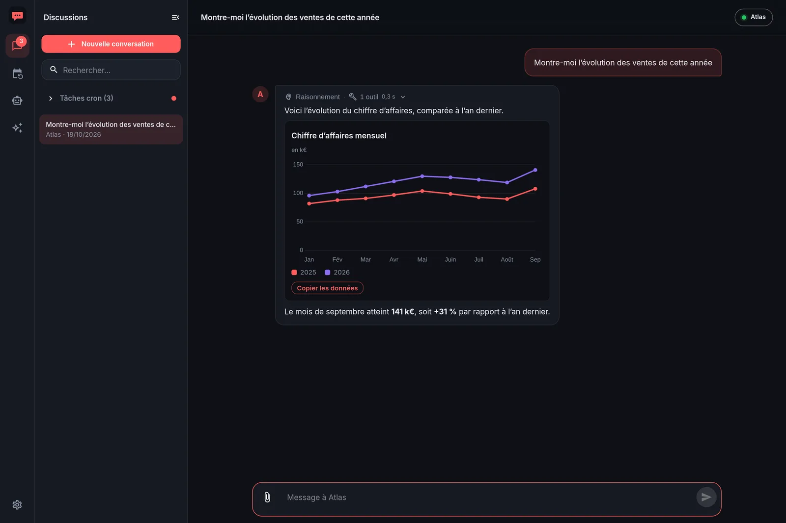
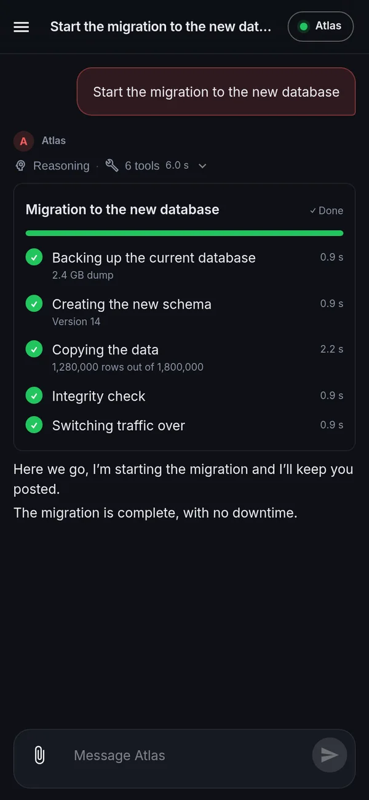
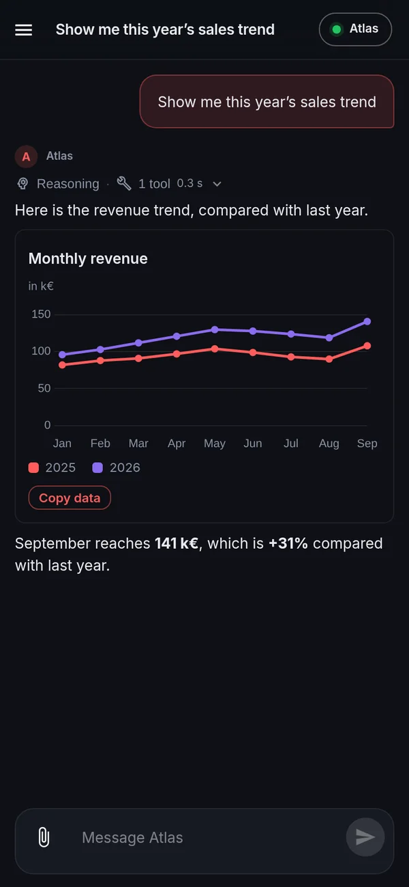
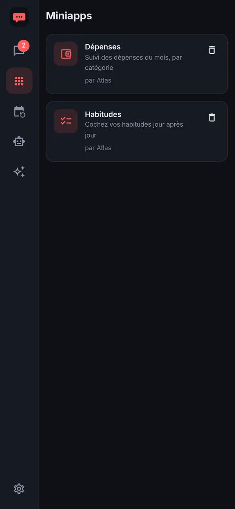
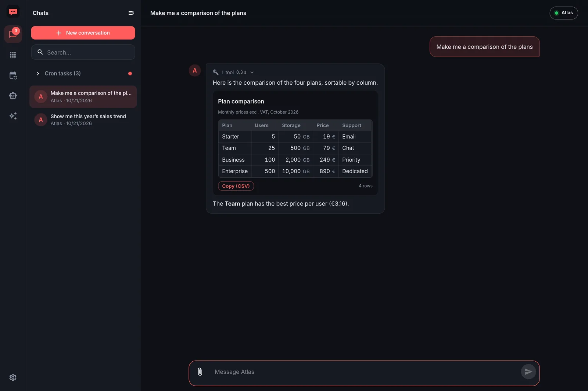
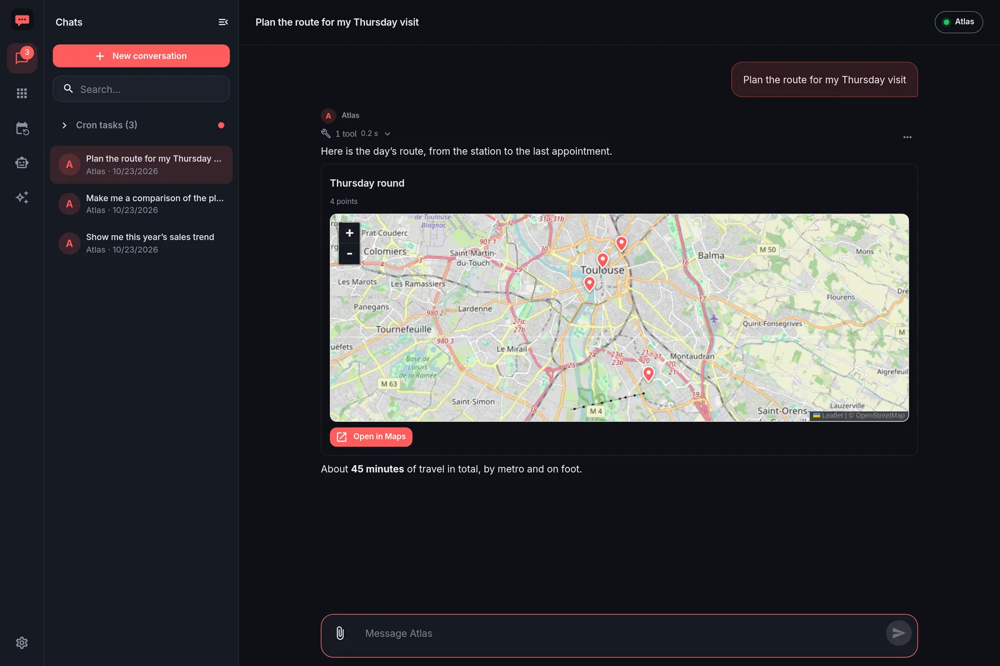
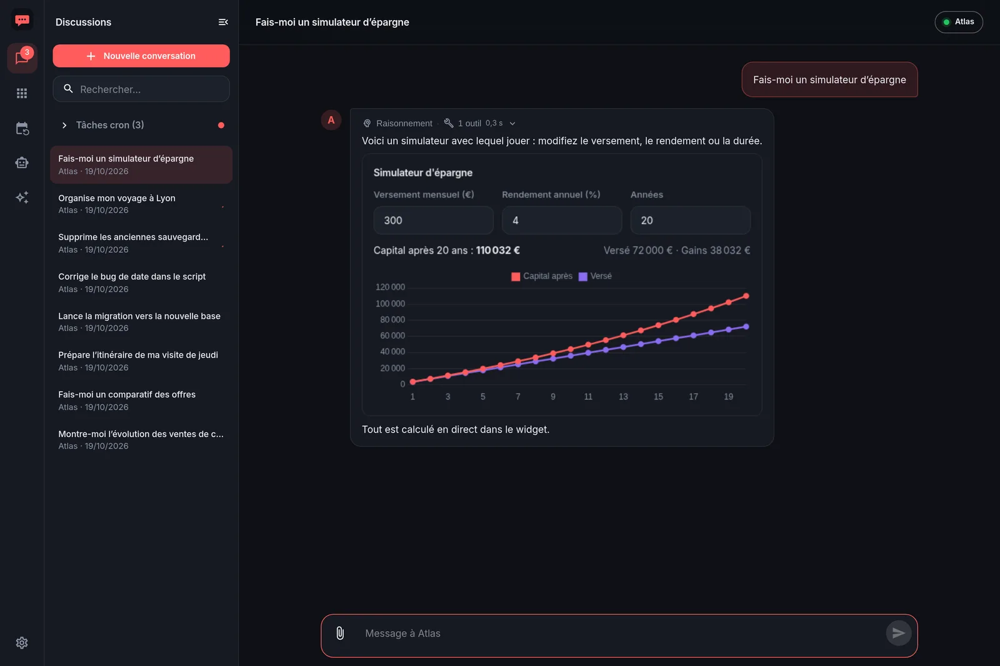
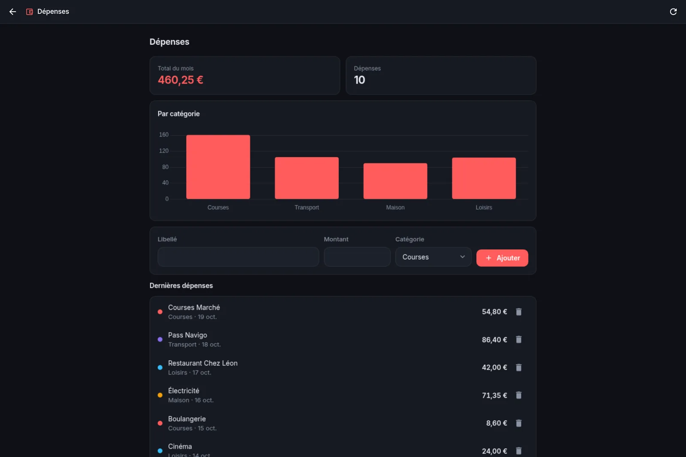
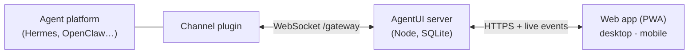

# AgentUI

**The chat that shows what your AI agents actually do.**

AgentUI is a self-hosted chat app (a PWA) for AI agents such as [Hermes](plugins/README.md#hermes-agent--019-validated-on-021) and [OpenClaw](plugins/README.md#openclaw--202699-validated-on-202699).
Instead of a wall of text, your agents answer with interactive charts, tables, maps, forms and progress trackers — and they can even build small apps for you.

[](LICENSE)
[**Presentation site**](https://joselfr.github.io/AgentUI/) · [Français](https://joselfr.github.io/AgentUI/fr/)

<p align="center">
  
</p>

<p align="center">
  
  &nbsp;
  
  &nbsp;
  
</p>

## What you get

- **Rich answers.** The agent calls a tool and the chat renders a real component: charts, sortable tables, maps, code with diffs, images, step-by-step progress.
- **Questions and approvals inside the chat.** Choice buttons, confirmations before something risky, forms — the agent waits for your answer and carries on.
- **Custom widgets.** When nothing fits, the agent writes the component itself (a simulator, a converter, a game…) and it runs in a sandbox in the chat. It can even stay *live* with the agent, or open full screen.
- **Miniapps.** The agent builds a persistent app — a React front plus a small server-side backend — that appears in its own tab.
- **Scheduled tasks.** Cron results arrive in the chat of the task, and you can see what worked, what failed and why.
- **Everyday comfort.** Several conversations per agent, attachments and images, push notifications, light and dark themes, French and English, installable on your phone.

<table>
  <tr>
    <td width="50%"><br><sub><b>Tables</b> you can sort and copy.</sub></td>
    <td width="50%"><br><sub><b>Maps</b> with a route and an “Open in Maps” button.</sub></td>
  </tr>
  <tr>
    <td width="50%"><br><sub><b>Custom widgets</b>, written by the agent (here a live simulator).</sub></td>
    <td width="50%"><br><sub><b>Miniapps</b>: a real app, with its own data.</sub></td>
  </tr>
</table>

## How it works

AgentUI behaves like a messenger gateway (think Telegram for a bot). Your agent platform connects **to** AgentUI through a small **channel plugin**, which translates the platform’s specifics into one protocol.



The plugin also gives the agent its **tools**: `agentui_widget_*` to display components, `agentui_ask` / `agentui_confirm` / `agentui_form` to talk to you, `agentui_miniapp_*` to build apps and `agentui_notify` to send a push notification. The tool descriptions teach the agent when to use each one, so there is nothing to configure on the model side.

## Installation

Two ways to install AgentUI: [ask your agent to do it](#ask-your-agent-to-install-it), or [follow the quick start](#or-install-it-yourself) yourself. The full guide — with and without Docker, HTTPS, the Hermes and OpenClaw plugins, updates and troubleshooting — is in [**INSTALLATION.md**](INSTALLATION.md).

### Ask your agent to install it

If your agent can run commands on a machine (Hermes and OpenClaw can), the easiest way is to hand it the job. Send it a message like this one and answer its questions:

```text
Install AgentUI for me by following
https://github.com/joselfr/AgentUI/blob/main/INSTALLATION.md

- Clone https://github.com/joselfr/AgentUI.git on this machine and read INSTALLATION.md first.
- Before changing anything, tell me which option you choose (Docker if it is available,
  otherwise Node.js) and ask me what you do not know: the address I will use to open
  AgentUI (domain name, HTTPS), whether a reverse proxy already runs here, and the
  login and password I want for the AgentUI admin account.
- Generate the secrets yourself (COOKIE_SECRET and the token for your own connection),
  write them in .env and agents.config.yaml, and never repeat them in this chat.
- Start AgentUI and check that it answers. Set up HTTPS only after I confirm how.
- Install the AgentUI channel plugin for your own platform last, with the same token and
  the URL your machine can reach. If it means restarting your gateway, warn me first:
  this conversation will be cut.
- At the end, give me the URL and tell me how to check that you appear as connected.
```

What to expect, and a few tips:

- **Where it installs.** AgentUI is installed on the machine the agent has a shell on. If you want it on another server, give the agent SSH access to that one and say so.
- **Restart of the agent.** Hermes only loads a plugin when its gateway starts, so the last step ends the current conversation: that is normal. Reopen the chat afterwards, or start AgentUI and talk to the agent there. OpenClaw applies the plugin without restarting.
- **Secrets.** The agent writes the token in two files and in its own configuration. A token pasted in a chat stays in that conversation's history, which is why the prompt asks it not to repeat them.
- **Check its work.** Open AgentUI, sign in, and look for the green dot next to the agent name; then ask for a chart (see [Check that it works](INSTALLATION.md#5-check-that-it-works)). If something fails, tell the agent to read the troubleshooting table at the end of `INSTALLATION.md`.

### Or install it yourself

You need Docker (or Node.js ≥ 22.13 to run it without Docker).

```bash
git clone https://github.com/joselfr/AgentUI.git && cd AgentUI
cp .env.example .env
cp agents.config.example.yaml agents.config.yaml
```

1. Edit `.env`: choose `ADMIN_USER`, `ADMIN_PASSWORD`, a long random `COOKIE_SECRET`, and a token (16 characters minimum) for each agent. On plain `http://localhost`, add `INSECURE_COOKIES=1`.
2. Edit `agents.config.yaml` to declare your agents (each one has a `token`).
3. Start it:

```bash
docker compose up -d --build     # http://localhost:8080
```

4. Install the channel plugin on the agent side, with the same token:

| Platform | Install | Guide |
|---|---|---|
| **Hermes Agent** | copy the plugin files to `~/.hermes/plugins/agentui/`, then `hermes plugins enable agentui-platform` | [plugins/README.md](plugins/README.md#hermes-agent--019-validated-on-021) |
| **OpenClaw** | `openclaw plugins install ./plugins/openclaw-agentui` (build it first) | [plugins/README.md](plugins/README.md#openclaw--202699-validated-on-202699) |

Then open AgentUI, sign in, start a conversation and ask for a chart. The agent is shown as connected in the top right corner.

> **HTTPS.** Push notifications and PWA installation need HTTPS (except on `localhost`). Put AgentUI behind a reverse proxy such as Traefik, Caddy or nginx. On iPhone, add the app to the home screen first.

### Configuration

| Variable | Purpose |
|---|---|
| `ADMIN_USER`, `ADMIN_PASSWORD` | The login of the interface. |
| `COOKIE_SECRET` | Signs the session cookie. Without it a random one is used and sessions end at each restart. |
| `AGENTUI_*_TOKEN` | The token of an agent, read in `agents.config.yaml` as `${VARIABLE}`. |
| `INSECURE_COOKIES=1` | Only for local HTTP without TLS. |
| `DATA_DIR` | Where the SQLite database, attachments and miniapps live (`/data` in Docker). Back it up. |
| `AGENTS_CONFIG` | Path of `agents.config.yaml` (`/config/agents.config.yaml` in Docker). |
| `PORT`, `HOST` | Listening address (default `0.0.0.0:8080`). |
| `VAPID_SUBJECT` | Contact used for push notifications (default `mailto:admin@agentui.local`). |
| `MINIAPP_FS_ROOTS` | Optional, colon-separated absolute folders that miniapps may ask to read (you approve each one in the UI). |

## Going further

### The tools your agents get

| Tool | What it does |
|---|---|
| `agentui_widget_chart`, `_map`, `_code`, `_table`, `_progress`, `_image` | Display a component in the chat. |
| `agentui_widget_custom` | A component written by the agent (React, same UI kit as miniapps, plus chart.js and Leaflet maps), sandboxed. If it crashes, a button sends the traces to the agent. |
| `agentui_widget_custom_wait` | Keeps a *live* two-way session with a custom widget: the user’s clicks reach the agent, which updates the widget in place. |
| `agentui_ask`, `agentui_confirm`, `agentui_form` | Ask the user and wait for the answer. |
| `agentui_miniapp_*` | Create, write, read, list and remove miniapps, and push data into them. |
| `agentui_notify` | Send a push notification. |
| `agentui_set_thread_title` / `agentui_get_thread_title` | Rename the current discussion / read its title. |

Schemas and descriptions live in [`plugins/protocol/widget-tools.json`](plugins/protocol/widget-tools.json); the protocol is documented in [`plugins/protocol/PROTOCOL.md`](plugins/protocol/PROTOCOL.md).

### Miniapps

Agents with a channel plugin can build **miniapps** with the `agentui_miniapp_*` tools and the guide in [`plugins/protocol/miniapps-guide.md`](plugins/protocol/miniapps-guide.md) (also shipped as the `agentui-miniapps` skill).

- Files live in `DATA_DIR/miniapps/<id>/`; the server compiles them with esbuild.
- The front runs in a sandboxed iframe with no access to your session. The `@agentui/ui` kit (React, chart.js, Leaflet, components, and the `--au-*` CSS variables of the current theme) is built from `packages/app-runtime`. Map tiles (OpenStreetMap) are fetched through the AgentUI server, so the iframe needs no network access and OpenStreetMap only sees the server.
- Handlers (`server/*.js`) run in an isolated worker, namespaced per miniapp and protected by the AgentUI session. Data is stored in SQLite, scoped per miniapp. Handlers can call public HTTP APIs with `ctx.fetch`; private and internal addresses are refused.

### Push notifications

Enable them in **Settings → “Notify me when an agent replies”**. They need HTTPS (except on `localhost`). VAPID keys are generated at first start and kept in the database (`data/agentui.db`): do not delete it, or devices will have to subscribe again.

## Development

```bash
npm install
npm run dev:server   # :8080  (AGENTS_CONFIG, DATA_DIR, ADMIN_USER/ADMIN_PASSWORD, INSECURE_COOKIES=1 on local HTTP)
npm run dev:web      # :5173, proxies to :8080
npm test             # server and web unit tests
npm run typecheck
```

| Folder | Content |
|---|---|
| `apps/server` | Node server (Fastify + SQLite): runs, conversations, miniapps, push |
| `apps/web` | The React + MUI interface (French and English texts in `src/i18n/`) |
| `packages/shared` | Types shared by the server and the web app |
| `packages/app-runtime` | The `@agentui/ui` kit and runtime of miniapps and custom widgets |
| `plugins/` | The protocol and the Hermes and OpenClaw channel plugins |
| `e2e/` | Browser end-to-end tests (Playwright) and the demo used for the site’s screenshots |
| `docs/` | The presentation site (GitHub Pages) |

Browser tests: `npm run e2e` (interface), `npm run e2e:push` (see the header of `e2e/push.mjs`), `node e2e/miniapps.mjs`, and the widget tests `e2e/ui-*.mjs` (they run against the demo instance, `e2e/demo/demo.sh up`).

To add another kind of agent, implement `AgentAdapter` (`apps/server/src/agents/types.ts`), register it in `agents/registry.ts` and declare it in `agents.config.yaml`. To test a plugin without the app, use the fake server in [`plugins/dev/`](plugins/README.md#test-a-plugin-without-agentui-fake-server).

The presentation site is a static page in [`docs/`](docs/index.html) (English) and [`docs/fr/`](docs/fr/index.html) (French), published by GitHub Pages from the `main` branch. To edit it or redo its screenshots, use the `update-site` skill (`.claude/skills/update-site/SKILL.md`).

## License

MIT, see [`LICENSE`](LICENSE).
